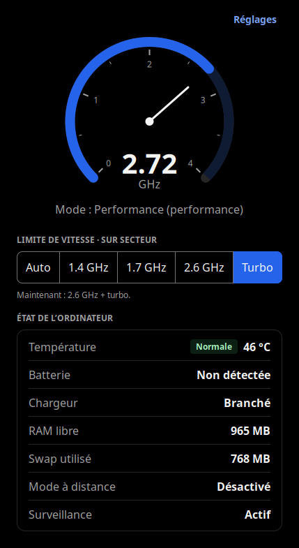
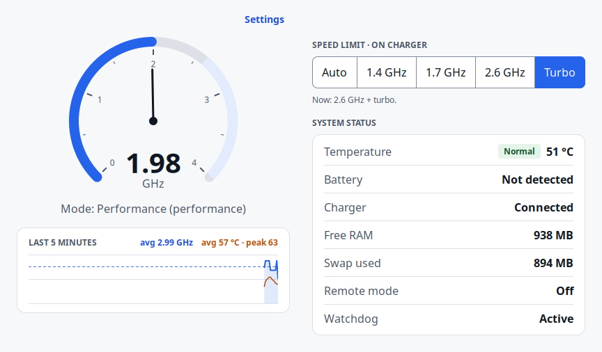

# cpu-freq

A CPU speedometer for Linux (C + GTK3) that also lets you **cap the processor speed** in one
click, and **works with auto-cpufreq** instead of fighting it.

| Light | Dark | AMOLED (French) |
| --- | --- | --- |
|  |  |  |

On short screens it switches to two columns:



- Current frequency (average of all cores) and CPU governor.
- A graph of the last 5 minutes of frequency and temperature, with the average frequency and
  the average and peak temperature over that window.
- Limit buttons built from your processor: **Auto**, its frequency levels and **Turbo**.
- Temperature (max of CPU/GPU), battery, charger, free RAM and used swap.
- A line under the buttons always shows the **real state** and warns you if the system is not
  keeping your choice.
- **Settings**: theme (system, light, dark, AMOLED), language (English, Español, Português,
  Français, Deutsch) and bottom bar.
- Fits small screens: below ~980 px of usable height (e.g. 1366×768) the window switches to two
  columns, about 860×510.

## Bottom bar

| Option | What it does | Memory |
| --- | --- | --- |
| **None** (default) | The app only runs while its window is open | 0 once closed |
| **Tray icon** | Mini speedometer in the tray (color follows temperature). Closing the window hides it; starts with your session. XEmbed trays (XFCE, MATE, Cinnamon) or StatusNotifierItem (KDE, GNOME with the AppIndicator extension, Wayland) | ~30 MB, always |
| **Panel plugin (XFCE)** | Mini speedometer and frequency inside the XFCE panel | ~30 kB inside the panel |

Clicking the tray icon or the panel plugin opens the window; clicking again while it is in
front hides it (tray) or closes it. **Right-click** either one to pick Auto, a frequency level
or Turbo without opening the window.

## Install

Download the `.deb` files from [Releases](../../releases) and run:

**Debian, Ubuntu, Linux Mint:** download the `.deb` files from [Releases](../../releases) and run:

```bash
sudo apt install ./cpu-freq_*_amd64.deb
sudo apt install ./cpu-freq-xfce_*_amd64.deb   # optional: XFCE panel plugin
```

**Arch Linux:** a `PKGBUILD` is in [`packaging/arch/`](packaging/arch/PKGBUILD). Copy it to an
empty folder and run `makepkg -si`.

**Other distributions:** see [Build](#build); `make install` takes `PREFIX`, `LIBEXECDIR`,
`PLUGDIR` and `DESTDIR`.

See [CHANGELOG.md](CHANGELOG.md) for what changed in each version.

## How it works

| You press | With auto-cpufreq | Without auto-cpufreq |
| --- | --- | --- |
| **Auto** | Restores your original values for that section | Removes the limit and turns turbo on |
| **1.4 GHz** (etc.) | Saves `turbo = never` and `scaling_max_freq` | Writes the limit and turns turbo off |
| **Turbo** | Saves `turbo = always`, no limit | Removes the limit and turns turbo on |

- With **auto-cpufreq**, the choice is saved in `/etc/auto-cpufreq.conf`, only in the section
  for the current power source (`[charger]` or `[battery]`), next to a `# cpu-freq: …` marker.
  auto-cpufreq watches that file and reloads it on its own; the service is never restarted.
  Before the first change, a copy is saved to `/etc/auto-cpufreq.conf.cpu-freq-orig`.
- The app decides whether you are on the charger with the same rule auto-cpufreq uses.
- Writing to the system needs root. A **minimal helper** (`/usr/libexec/cpu-freq/ayudante`)
  does it through `pkexec`. The polkit action needs no password for the active local session
  and is denied to remote or inactive sessions.
- The helper only accepts `auto`, `turbo` or a frequency in kHz that the processor supports
  (`scaling_available_frequencies`, or the `cpuinfo_min_freq`–`cpuinfo_max_freq` range).
  It never takes a path.

## Compatibility

| Driver / case | Status |
| --- | --- |
| `acpi-cpufreq` (AMD Ryzen 3 3250U), Linux Mint 22.3 XFCE, auto-cpufreq 3.2.0 | Tested |
| XFCE 4.18 tray and panel plugin | Tested |
| `amd-pstate` / `amd-pstate-epp` (continuous range, `cpufreq/boost`) | Not tested |
| `intel_pstate` (continuous range, `intel_pstate/no_turbo`) | Not tested |
| `[battery]` section (laptop unplugged) | Not tested |
| auto-cpufreq installed as a snap | Not tested |
| Tray icon through StatusNotifierItem (needs `libayatana-appindicator3`) | Tested on XFCE's SNI host |
| Tray icon on KDE Plasma and GNOME (AppIndicator extension) | Not tested |
| Arch Linux PKGBUILD | Install paths tested; `makepkg` not tested |
| auto-cpufreq config in root's `~/.config` | Not supported: `/etc/auto-cpufreq.conf` is used |

If you try it on other hardware, please open an issue with the result.

## Color thresholds

Defaults: high temperature 85 °C, critical 95 °C, low battery 25 %, minimum RAM 250 MB.
Change them in `~/.config/cpu-freq.conf`, where the app also stores its settings:

```ini
TEMP_AVISO=85
TEMP_CRITICA=95
BATERIA_BAJA=25
RAM_MINIMA=250
```

## Build

```bash
sudo apt install build-essential pkg-config libgtk-3-dev libxfce4panel-2.0-dev librsvg2-bin gettext dpkg-dev
make build     # app, helper, translations, icons and panel plugin in build/
make test      # 67 checks of the root helper, without root, against fake sysfs trees
make deb       # cpu-freq and cpu-freq-xfce packages in build/
sudo make install install-xfce   # or install straight into /usr
make clean
```

Without `libxfce4panel-2.0-dev`, everything except the panel plugin is built. Paths can be
changed with `PREFIX`, `LIBEXECDIR`, `PLUGDIR`, `LICENSEDIR` and `DESTDIR`; the helper path is
compiled into the app and the plugin and written into the polkit action, so pass the same
values to `build` and `install`.

`make test` builds a test-only copy of the helper whose system paths point at
`build/prueba/raiz`, then checks it against fake trees: the argument whitelist, charger and
battery sections, restoring Auto, a desktop with no battery, no auto-cpufreq, auto-cpufreq
without a config file, `intel_pstate` (continuous range, inverted `no_turbo`) and a machine
without cpufreq. The GitHub Action runs it before building the packages.

## Translations

UI strings are in English in the source code. Translations live in `po/<lang>.po`. To add a
language, copy `po/cpu-freq.pot` to `po/<code>.po`, translate it and add the code to
`IDIOMAS` in the `Makefile`. `make pot` extracts the strings again when they change.

## Memory

About 33 MB RSS with the window open (the same in the background if you pick the tray icon).
An empty GTK3 window already takes ~30 MB on the same machine, mostly libraries shared with
the rest of the desktop (PSS ≈ 9 MB).

## License

[MIT](LICENSE). It contains no auto-cpufreq code: it only edits its configuration file.
