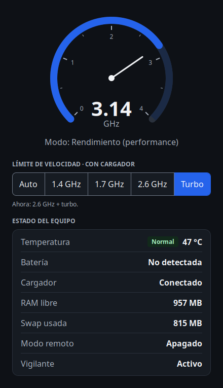

# cpu-freq

Velocímetro del procesador para Linux (C + GTK3) que además deja **limitar la velocidad**
con un clic y **controla auto-cpufreq** en lugar de pelearse con él.

| Claro | Oscuro |
| --- | --- |
|  |  |

- Frecuencia actual (promedio de los núcleos) y modo del procesador (governor).
- Botones de límite generados según tu procesador: **Auto**, los niveles de frecuencia y **Turbo**.
- Temperatura (máximo CPU/GPU), batería, cargador, RAM libre y swap usada.
- Una línea bajo los botones dice siempre el **estado real** y avisa si el sistema no respeta tu elección.
- Sin bandeja ni proceso en segundo plano: lee cada 1.5 s solo mientras la ventana está abierta.

## Instalar

Descarga el `.deb` de [Releases](../../releases) y:

```bash
sudo apt install ./cpu-freq_*_amd64.deb
```

## Cómo funciona

| Pulsas | Con auto-cpufreq | Sin auto-cpufreq |
| --- | --- | --- |
| **Auto** | Devuelve la sección a tus valores originales | Quita el límite y enciende el turbo |
| **1.4 GHz** (etc.) | Guarda `turbo = never` y `scaling_max_freq` | Escribe el límite y apaga el turbo |
| **Turbo** | Guarda `turbo = always`, sin límite | Quita el límite y enciende el turbo |

- Con **auto-cpufreq**, la elección se guarda en `/etc/auto-cpufreq.conf`, solo en la sección
  de la fuente de energía actual (`[charger]` o `[battery]`), con una marca `# cpu-freq: …`.
  auto-cpufreq vigila ese archivo y lo recarga solo; no hace falta reiniciar el servicio.
  Antes del primer cambio se guarda una copia en `/etc/auto-cpufreq.conf.cpu-freq-orig`.
- La regla para saber si hay cargador es la misma que usa auto-cpufreq.
- Escribir en el sistema requiere root. Lo hace un **ayudante mínimo**
  (`/usr/libexec/cpu-freq/ayudante`) lanzado con `pkexec`. La acción de polkit no pide
  contraseña a la sesión local activa y la niega a sesiones remotas o inactivas.
- El ayudante solo acepta `auto`, `turbo` o una frecuencia en kHz que el procesador admita
  (`scaling_available_frequencies` o el rango `cpuinfo_min_freq`–`cpuinfo_max_freq`).
  Nunca recibe rutas.

## Compatibilidad

| Driver / caso | Estado |
| --- | --- |
| `acpi-cpufreq` (AMD Ryzen 3 3250U), Linux Mint 22.3, auto-cpufreq 3.2.0 | Probado |
| `amd-pstate` / `amd-pstate-epp` (rango continuo, `cpufreq/boost`) | Sin probar |
| `intel_pstate` (rango continuo, `intel_pstate/no_turbo`) | Sin probar |
| Sección `[battery]` (portátil desconectado) | Sin probar |
| auto-cpufreq instalado como snap | Sin probar |
| Configuración de auto-cpufreq en `~/.config` de root | No soportado: se usa `/etc/auto-cpufreq.conf` |

Si lo pruebas en otro equipo, abre un issue con el resultado.

## Umbrales de color

Por defecto: temperatura alta 85 °C, crítica 95 °C, batería baja 25 %, RAM mínima 250 MB.
Se pueden cambiar en `~/.config/cpu-freq.conf`:

```ini
TEMP_AVISO=85
TEMP_CRITICA=95
BATERIA_BAJA=25
RAM_MINIMA=250
```

## Compilar

```bash
sudo apt install build-essential pkg-config libgtk-3-dev librsvg2-bin dpkg-dev
make build     # binarios en build/
make deb       # paquete en build/
make prueba    # prueba el ayudante sin root sobre una copia de /etc/auto-cpufreq.conf
make clean
```

## Memoria

Unos 33 MB de RSS con la ventana abierta. Una ventana GTK3 vacía ya ocupa ~30 MB en el mismo
equipo, casi todo en bibliotecas compartidas con el resto del escritorio (PSS ≈ 9 MB).

## Licencia

[MIT](LICENSE). No incluye código de auto-cpufreq: solo edita su archivo de configuración.
